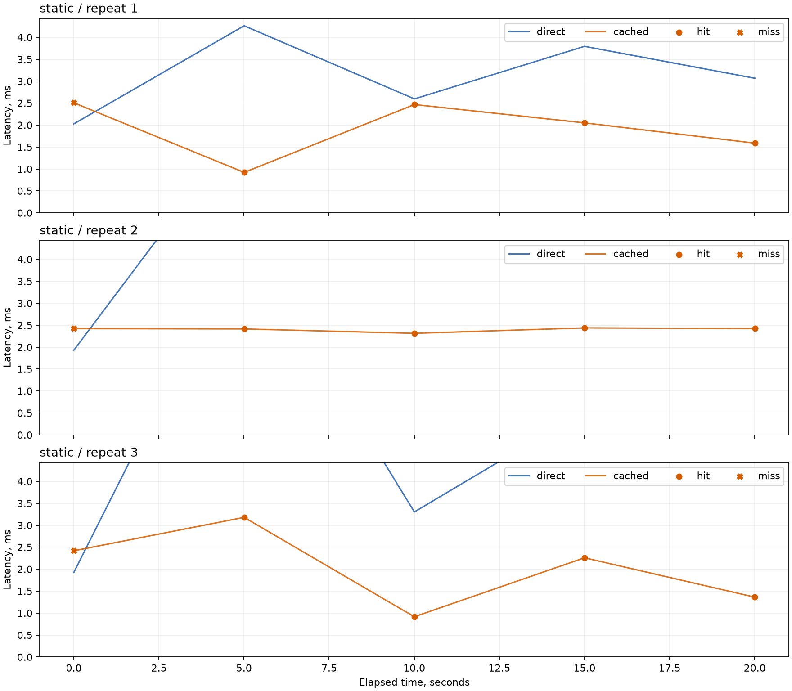
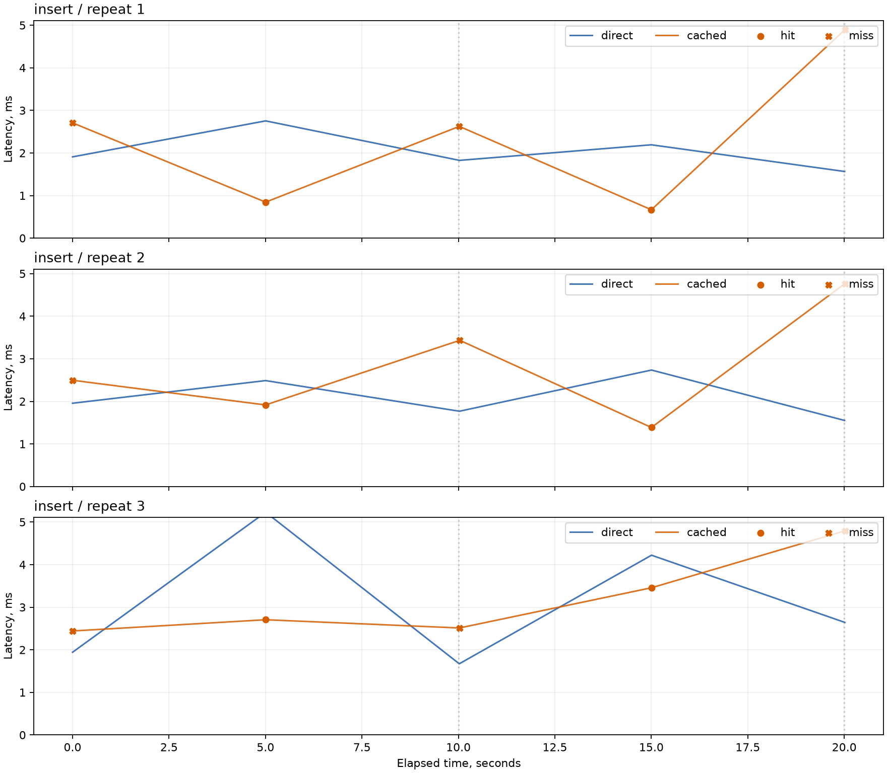
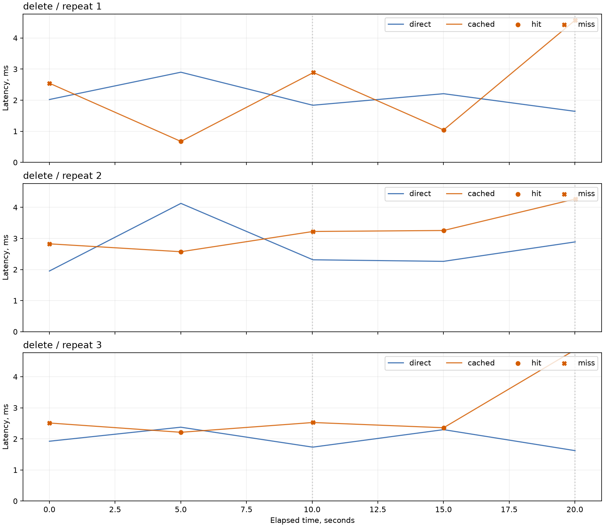
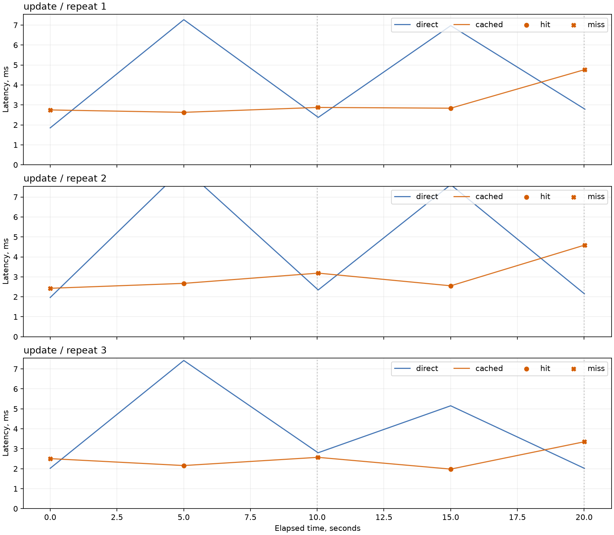

# ЛР9: результаты сравнения PostgreSQL и Redis

Проверочный эксперимент. Эти результаты не заменяют 24 прогона по 300 секунд из RFC.

## Условия

- Корректных прогонов: 24; исключено: 0.
- Длительность: 20 с; чтение каждые 5 с; изменение каждые 10 с.
- TTL: 3600 с; пять прогревочных SQL перед каждым прогоном.
- Исходные количества строк: `{"suppliers": 1000, "products": 1000, "warehouses": 1000, "warehouse_sections": 3000, "deliveries": 5006}`.
- SHA-256 снимка: `e228b6b7876528637c6dc2a19c96ac4c007c6c025b441d1d004a3a38be1ce274`.
- После восстановления в экспериментальной копии очищается `lr5.delivery_documents`: её FK запрещает удаление всех исходных поставок. Данные ЛР1 и ограничения сохраняются; основная БД не изменяется.
- Версия SQL: `cd451a332561306ed255a50066fb339766e0ed8527331ad45d8855dd82615df9`.
- Среда: macOS-26.6.2-arm64-arm-64bit-Mach-O; Python 3.13.15.
- PostgreSQL: PostgreSQL 17.11 on aarch64-unknown-linux-musl, compiled by gcc (Alpine 15.2.0) 15.2.0, 64-bit.

Время включает получение и преобразование результата, а при miss также заполнение Redis. Соединения, запись, инвалидация и контрольный SQL не входят в интервал. После каждого чтения выполнен контрольный SQL: это дополнительно прогревает PostgreSQL в обоих режимах. Первый miss включён. p95 вычислен методом nearest-rank. Изменения выполнялись до чтения на общем дедлайне.

## Сводные показатели

| Сценарий | Режим | Повтор | n | Mean, мс | Median, мс | p95, мс | Hit rate | SQL сервиса | Ускорение |
| --- | --- | --- | --- | --- | --- | --- | --- | --- | --- |
| delete | cached | 1 | 5 | 2.345 | 2.546 | 4.576 | 40.0% | 3 | 0.90× |
| delete | direct | 1 | 5 | 2.122 | 2.021 | 2.900 | 0.0% | 5 | 0.90× |
| delete | cached | 2 | 5 | 3.231 | 3.225 | 4.272 | 40.0% | 3 | 0.84× |
| delete | direct | 2 | 5 | 2.709 | 2.313 | 4.128 | 0.0% | 5 | 0.84× |
| delete | cached | 3 | 5 | 2.896 | 2.511 | 4.870 | 40.0% | 3 | 0.69× |
| delete | direct | 3 | 5 | 1.991 | 1.924 | 2.376 | 0.0% | 5 | 0.69× |
| insert | cached | 1 | 5 | 2.348 | 2.624 | 4.897 | 40.0% | 3 | 0.87× |
| insert | direct | 1 | 5 | 2.049 | 1.908 | 2.754 | 0.0% | 5 | 0.87× |
| insert | cached | 2 | 5 | 2.800 | 2.496 | 4.766 | 40.0% | 3 | 0.75× |
| insert | direct | 2 | 5 | 2.100 | 1.956 | 2.736 | 0.0% | 5 | 0.75× |
| insert | cached | 3 | 5 | 3.182 | 2.705 | 4.794 | 40.0% | 3 | 0.99× |
| insert | direct | 3 | 5 | 3.141 | 2.643 | 5.230 | 0.0% | 5 | 0.99× |
| static | cached | 1 | 5 | 1.907 | 2.050 | 2.508 | 80.0% | 1 | 1.65× |
| static | direct | 1 | 5 | 3.149 | 3.067 | 4.262 | 0.0% | 5 | 1.65× |
| static | cached | 2 | 5 | 2.402 | 2.422 | 2.438 | 80.0% | 1 | 2.33× |
| static | direct | 2 | 5 | 5.600 | 6.683 | 7.780 | 0.0% | 5 | 2.33× |
| static | cached | 3 | 5 | 2.027 | 2.259 | 3.180 | 80.0% | 1 | 2.57× |
| static | direct | 3 | 5 | 5.215 | 5.605 | 9.631 | 0.0% | 5 | 2.57× |
| update | cached | 1 | 5 | 3.171 | 2.836 | 4.767 | 40.0% | 3 | 1.34× |
| update | direct | 1 | 5 | 4.250 | 2.785 | 7.270 | 0.0% | 5 | 1.34× |
| update | cached | 2 | 5 | 3.085 | 2.673 | 4.589 | 40.0% | 3 | 1.46× |
| update | direct | 2 | 5 | 4.506 | 2.342 | 8.453 | 0.0% | 5 | 1.46× |
| update | cached | 3 | 5 | 2.514 | 2.505 | 3.352 | 40.0% | 3 | 1.54× |
| update | direct | 3 | 5 | 3.883 | 2.800 | 7.422 | 0.0% | 5 | 1.54× |

Ускорение — mean(direct) / mean(cached) внутри одного повтора; включает промахи. Min/max, длительности hit/miss, ошибки и контрольные SQL сохранены в `summary.csv`.

## Графики и выводы

### static

Диапазон ускорения по повторам: 1.65–2.57×.

### insert

Диапазон ускорения по повторам: 0.75–0.99×.

### delete

Диапазон ускорения по повторам: 0.69–0.90×.

### update

Диапазон ускорения по повторам: 1.34–1.54×.

На статических данных кэш заполняется один раз. При изменениях каждая подтверждённая запись инвалидирует ключ; следующее чтение выполняет SQL и заполняет Redis. Поэтому выигрыш от попаданий нужно оценивать вместе со стоимостью промахов. Коэффициент ниже 1 означает замедление.

Измерения относятся к локальному стенду, указанному объёму данных и прогретой PostgreSQL. Малое число точек в коротком прогоне делает p95 чувствительным к единичным задержкам. Для итоговых выводов следует использовать полный эксперимент. Версии пакетов, образы и ограничения БД доступны в metadata.json каждого прогона.
